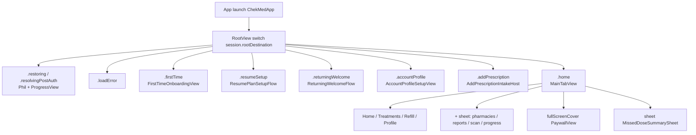
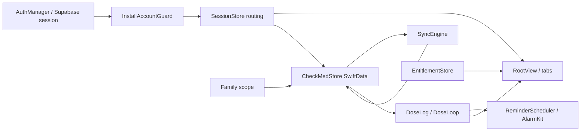

# CONNY COOPER — MASTER APP WORKFLOW & NAVIGATION ARCHITECTURE

> **Status:** architecture contract for routing, onboarding, authentication, dashboard, medication, subscription, family/caregiver, and **public branding vs legacy technical identifiers**.  
> **Evidence base:** source inspection of HEAD `bbda419b1cc2852317a7551273c21e0974368c1a` (`fix(onboarding): ship Welcome routing, install owner guard, and build 6`) unless a claim is labeled otherwise. Branding inventory in §13 used the same HEAD (read-only; no runtime).  
> **Companion UI inventory:** `docs/design-reference/Conny Cooper — Current Screens, Workflows & Design Reference.md` (audited 18 Oct 2026 against `331ac9c` plus a dirty tree). This file is the **routing/state contract**; that file is the **screen/visual inventory**.  
> **Official public identity (required for all future customer-facing copy):** product **Conny Cooper**; companion character **Dr. Cooper**; website **https://connycooper.com**; support **support@connycooper.com**.  
> **Legacy technical identifiers (must be preserved):** iOS bundle ID `com.checkmed.app`; Xcode project/target `ChekMed`; Swift types, UserDefaults keys, Keychain services, StoreKit product IDs, and URL-scheme tokens that already use CheckMed / ChekMed / `checkmed`. Changing those is not a “rename”; it is a persistence and OAuth breakage.  
> **This document does not authorize a redesign, a screen reorder, or a rebrand of identifiers.** Product-approved journeys in Part 3 are TARGET REQUIREMENTS, not an implementation order. Branding discrepancies in §9 / §13 are **not** the Google splash-loop defect and must not be folded into that fix.  
> **Freeze 1 (21 Oct 2026):** routing/auth/quiet-day/DEBUG-contract code at `bce3ed2`. See §14.  
> **Pre-Build 9 source freeze (22 Oct 2026):** app Swift checkpoint `6943727fec1dd95cb938abe6f4c28715821ac2b9` (includes Freeze 1 plus tab-hosted Add Prescription clearance). Does **not** authorize Build 9, TestFlight, archive, identifier changes, or a calendar launch deadline.

**Evidence labels**

| Label | Meaning |
| --- | --- |
| SOURCE VERIFIED | Confirmed in Swift source at the cited symbol. |
| RUNTIME VERIFIED | Observed on a running app (simulator or device). **Not used in this document.** |
| NOT VERIFIED | Plausible from source, but not proven at runtime. |
| PLANNED | Product intent / roadmap; not implemented as specified. |
| KNOWN DEFECT | Confirmed failure mode; **do not treat as intended behavior.** |

Do not upgrade SOURCE VERIFIED to RUNTIME VERIFIED.

**Canonical medication chain (frozen):** Prescription → Medicine → Treatment → DoseSchedule → DoseLog → DoseLoop → adherence / Journey / reports / gamification. `DoseLog.scheduleId → DoseSchedule.medicineId → Medicine.treatmentId`. Do not invent DoseLogs or a second medication truth.

### Freeze log

| Freeze | Baseline | Scope | Not in scope |
| --- | --- | --- | --- |
| **1** — 21 Oct 2026 | `bce3ed2b3be5245187291cfff972399d0eb1097d` | Splash/onboarding routing; authentication + `InstallAccountGuard`; quiet-day Dashboard presentation; DEBUG onboarding contract runner (`CHECKMED_DEBUG_ONBOARDING_CONTRACTS`) | Build 9 / archive / TestFlight; DoseLoop production; reminders/AlarmKit; Super/IAP; Confirm source viewer (then unverified); physical iPhone 11; identifier/branding migrations |
| **2** — 22 Oct 2026 | `6943727fec1dd95cb938abe6f4c28715821ac2b9` | Freeze 1 plus presentation-only tab-bar clearance on tab-hosted Add Prescription (`clearsFloatingTabBar`). User-confirmed Confirm photo/PDF preview and Add Prescription layout. | Build 9 / archive / TestFlight; DoseLoop production; AlarmKit; Super IAP E2E; family extra-profile cloud sync; Reports archived-source viewing; physical iPhone 11; identifier/branding migrations |

---

## 1. Executive overview

Conny Cooper is a single-window SwiftUI iOS app. There is **one root destination** owned by `SessionStore.rootDestination`, computed by `OnboardingWelcomeRouting.appRoot(_:)`, and switched in `RootView.body`. SOURCE VERIFIED: `SessionStore.computeRootDestination()`, `OnboardingWelcomeRouting.appRoot`, `RootView.body`.

**Name vs identifier:** Home-screen display name is **Conny Cooper** (`INFOPLIST_KEY_CFBundleDisplayName`). The process, target, and most persistence keys remain **ChekMed / checkmed**. See §13. SOURCE VERIFIED. Future customer-visible strings must say Conny Cooper / Dr. Cooper; they must **not** rename the bundle ID or target to match.

**Live shell after unlock:** `MainTabView` has **four** tabs — Home, Treatments, Refill, Profile. Pharmacies, Reports, Scan, and Progress open from the floating **+** menu (Treatments and Refill only). SOURCE VERIFIED: `MainTabView`, `FloatingPlusMenu`.

**Onboarding is not a second app.** First-time steps live in `FirstTimeOnboardingView` (`FirstTimePhase`) while `rootDestination == .firstTime`. Returning / configured users must leave that host for `.home` (or resume / profile / add-prescription roots). SOURCE VERIFIED: `OnboardingWelcomeRouting.appRoot` lines 183–189, `enterReturningAfterAuth`.

**Competing coordinators (architectural risk):**

1. `RootView` / `SessionStore.rootDestination` — process-level route.
2. `FirstTimeOnboardingView.phase` — in-memory first-time step, seeded from UserDefaults `checkmed.firstTimePhase`.
3. `AppRoute` navigation stacks inside tabs, + menu, and profile.
4. `OnboardingWelcomeRouting.hostPhase` — pure function for Welcome / Care / Profile **inside** the first-time host.

A change that only updates (2) can be discarded when (1) remounts `FirstTimeOnboardingView()`. A change that only updates UserDefaults flags can disagree with Keychain (`ProfileSetupKeychain`) and SwiftData treatments.

**Splash-loop (source fix, not runtime-verified):** Google (and Apple) provider UI backgrounds the app while unsigned and Google `isLoading == false`. Protection is `AuthManager.isProviderAuthenticationUIPresented`, set before present. Replay/`restartPreAuthOnboarding` must not clear funnel flags during that window. See §9. IMPLEMENTED — NOT TESTED.

---

## 2. Root navigation diagram

SOURCE VERIFIED: `OnboardingWelcomeRouting.appRoot`, `RootView`.

**Ladder (highest first)** — SOURCE VERIFIED `OnboardingWelcomeRouting.appRoot`:

1. Launch restore not released and `auth.isRestoring` → `.restoring`
2. Session unlocked and user-data **failed** → `.loadError`
3. Not a returning-configured user, and language/privacy/this-install sign-in or session incomplete → `.firstTime`
4. Session locked → `.firstTime`
5. `isResolvingPostAuth` or unlocked but user-data / plan-surface not ready → `.resolvingPostAuth`
6. Active post-journey or `showResumeSetup` → `.resumeSetup`
7. Returning-welcome gate → `.returningWelcome` (must not be set from Google login; `preparePostAuth` clears it)
8. Needs identity and not returning-configured → `.firstTime` (if Welcome/Care still due) else `.accountProfile`
9. `startFreshPrescription` → `.addPrescription`
10. Active first-time intake phase → stay `.firstTime`
11. Not onboarded and not returning-configured → `.firstTime`
12. Else `.home`

`.resolvingPostAuth` and `.restoring` share the **same** `RootView.restoring` UI (Phil + spinner + `restoringPlan`). That is **not** `SplashView`. SOURCE VERIFIED: `RootView` cases `.restoring, .resolvingPostAuth`.

---

## 3. Full screen inventory

Reachability:

- **Reachable** — presented on a live `RootView` / tab / first-time phase / sheet path in current source.
- **Conditional** — same, but only for a flag, entitlement, error, or incomplete plan.
- **Unreachable** — type exists; no live presenter found at HEAD.
- **DEBUG-only** — isolated contract hosts; not production TestFlight.

Session requirement: **unsigned** = `SessionStore.kind != .authenticated`; **unlocked** = `isSessionUnlocked`.

### 3.1 Process roots (`RootView`)

| Screen | File / symbol | Purpose | Entry | Exit | Back/cancel | State | Session | Status |
| --- | --- | --- | --- | --- | --- | --- | --- | --- |
| Restoring plan | `RootView.restoring` | Hide UI until launch session or post-auth replica settles | `.restoring`, `.resolvingPostAuth` | Next root when flags change | None | `auth.isRestoring`, `isResolvingPostAuth`, `userDataLoadState`, `isPlanSurfaceReady` | Any | SOURCE VERIFIED reachable |
| Plan load error | `RootView.loadError` | Replica failed and no local treatments | `.loadError` | Retry → `retryUserDataLoad()` | Retry button | `userDataLoadState == .failed` | Unlocked | SOURCE VERIFIED conditional |
| First-time host | `FirstTimeOnboardingView` | Entire pre-Home funnel | `.firstTime` | Root leaves host | Per-phase | `FirstTimePhase`, UserDefaults funnel | Mixed | SOURCE VERIFIED reachable |
| Resume setup | `ResumePlanSetupFlow` | Post-journey alarms / notifications / trial / Phil | `.resumeSetup` | `finishResumeSetup()` → Home | Queue-specific | `postJourneyStep`, `showResumeSetup` | Unlocked | SOURCE VERIFIED conditional |
| Miss-you | `ReturningWelcomeFlow` | “Phil missed them” then Progress or add Rx | `.returningWelcome` | Home / add host | Add cancel returns to miss-you | `needsReturningWelcomeGate` | Unlocked | SOURCE VERIFIED **conditional / rarely used** — Google login explicitly must not set this (`SessionStore` comment; `preparePostAuth` / `decidePostRestoreRoute` clear it) |
| Account profile (root) | `AccountProfileSetupView` | Name / sex / pronouns / DOB after sign-in | `.accountProfile` | `markProfileSetupComplete()` | `showsSignOut` on first-time embed | `needsIdentityProfile` | Unlocked | SOURCE VERIFIED conditional |
| Add prescription (root) | `AddPrescriptionIntakeHost` | User-started later add | `.addPrescription` | `beginResumeSetup` / `finishFreshPlan` | `onCancel` | `startFreshPrescription` | Unlocked | SOURCE VERIFIED conditional |
| Main tabs | `MainTabView` | Dashboard shell | `.home` | Sign-out / deletion | Tab bar | `selectedMainTab`, plan surface | Unlocked + configured or completed onboarding | SOURCE VERIFIED reachable |
| Super paywall | `PaywallView` | StoreKit Super | `RootView.fullScreenCover` `entitlements.showPaywall` | Dismiss / purchase | Navigation | `EntitlementStore` | Unlocked typical | SOURCE VERIFIED conditional |
| Missed-dose sheet | `MissedDoseSummarySheet` | Unresolved doses | `RootView.sheet` | Done / empty | X / Done | `CheckMedStore.unresolvedDosesForSummary` | Home + restoration complete | SOURCE VERIFIED conditional |
| Medicine ceiling | alert on `RootView` | Free/Super cap | `entitlements.showSuperMedicineCeiling` | OK | OK | capacity gate | Unlocked | SOURCE VERIFIED conditional |
| Unfinished-plan alert | alert on `RootView` | Leave-health warning | `session.showLeaveHealthWarning` | OK | OK | `needsUnfinishedPlan` | Unlocked | SOURCE VERIFIED conditional |

### 3.2 First-time phases (`FirstTimeOnboardingView`)

SOURCE VERIFIED: `FirstTimePhase`, `FirstTimeOnboardingView.body`.

Implemented host order (not the Part 3 target):

**Splash → Language → Privacy/Terms → Sign-in → How-it-works (Welcome) → Care context → Profile → Add medication → capture/analyse/confirm → Journey (`PlanResumeView`) → Alarm → Notifications → Super trial → Phil ready.**

| Phase | View | Entry | Exit | Back | Notes |
| --- | --- | --- | --- | --- | --- |
| `.splash` | `SplashView` | Host appear / `bootstrapPhase` / **KNOWN DEFECT** restart | Open → `markIntroSplashSeen` then `afterSplash` | None | Not persistable (`FirstTimePhase.persistable`) |
| `.language` | `LanguageOnboardingView` | After splash or incomplete funnel | `markLanguageChosen` → privacy | None | UserDefaults `checkmed.languageChosen` |
| `.privacy` | `PrivacyConsentView` | After language | Accept → **always** `.signIn` (comment: restored Apple must not skip) | Links to legal docs | `acknowledgePrivacy()` |
| `.signIn` | `SignInView` in `NavigationStack` | After privacy | `onAuthenticated` → `routeAfterAuthIfNeeded` | None on landing | Must not skip for leftover Keychain (`SignInView.requestOrConfirmProvider`) |
| `.howItWorks` | `HowItWorksView` | After auth if Welcome due | Skip/Continue → Care or next | None | **After** sign-in in implementation |
| `.careContext` | `CareContextOnboardingView` | After Welcome if no context | Continue | None | Optional for returning; skipped if `isReturningAuthenticated` |
| `.profile` | `AccountProfileSetupView` | After care / if identity incomplete | Finished → add medication | Sign out if `showsSignOut` | Name + DOB required; pronouns/gender optional |
| `.addMedication` | `OnboardingAddMedicationView` | After profile | Photo / library / PDF / manual | Back to profile only if identity still incomplete | Super capacity gate |
| `.camera` | `OnboardingCameraView` | Photo path | Capture → analysing | Back to add | Camera permission string in Info.plist |
| `.manualEntry` | `OnboardingManualEntryView` | Manual path | Continue → analysing | Back to add | |
| `.analysing` | `OnboardingAnalysingView` | Import | Detection / confirm | — | Not persistable |
| `.slotLimit` | `ScanSlotLimitView` | Over Free/Super cap | Super unlock or subset | Back to add | |
| `.confirm` | `OnboardingConfirmView` | After analysis | Confirm seeds plan | Back | Confirm Medicine: source preview → full-screen original is product behavior |
| `.planResume` | `PlanResumeView` | After confirm / journey | Continue → `commitOnboardingPlan` + post-journey | — | **Confirm does not persist; Continue commits** (`commitOnboardingPlan` → `seedFromDrafts`) |
| `.organize` | `OnboardingOrganizeView` | Mapped from older saved phase | Mapped to alarm setup | — | Resume mapping in `destinationAfterSplash` |
| `.notifications` | post-journey | Queue | Next | — | `UNUserNotificationCenter` request |
| `.alarmSetup` | post-journey | Queue | Next | — | AlarmKit usage string in project |
| `.trial` | `OnboardingSuperTrialView` | Queue if Free | Continue / purchase | — | StoreKit |
| `.ready` | `OnboardingPhilReadyView` | Queue end | `finishResumeSetup` | — | Then Home |

Legal sub-screens from privacy: `LegalDocumentView`, `PrivacySettingsView` (`PrivacyConsentView` NavigationLink). SOURCE VERIFIED.

**`WelcomeView` (`WelcomeView.swift`)** — Get Started / Have account. **Unreachable:** no `WelcomeView(` call site. SOURCE VERIFIED.

### 3.3 Sign-in

| Screen | File | Entry | Exit | Notes |
| --- | --- | --- | --- | --- |
| Landing | `SignInView.landing` | First-time `.signIn` | Apple / Google / email form | “Welcome back” copy if `showWelcomeBack` |
| Email login / signup / reset | `SignInView.form` | Continue with email | Submit / providers | `AuthManager.signIn` / `signUp` / `resetPassword` |
| Google | GID SDK | Provider button | Callback `onOpenURL` | `completeGoogleSignIn` / `exchangeGoogleTokens` |
| Apple | `AppleSignInCoordinator` | Provider button | `signInWithIdToken` | Deletion uses a **second** Apple sheet for authorization code only |

Required: non-nil `AuthManager.client` (Info.plist `SUPABASE_URL` https + `SUPABASE_ANON_KEY`) and `GIDClientID` for Google. Empty keys show the Secrets.xcconfig banner. SOURCE VERIFIED: `AuthManager.configureClient`, `signInWithGoogle`.

### 3.4 Dashboard tabs and + menu

SOURCE VERIFIED: `MainTabView`, `FloatingPlusMenu`, `PlusMenuDestinationHost`.

| Surface | File | Entry | Exit | Notes |
| --- | --- | --- | --- | --- |
| Home | `HomeView` | Tab `.home`; notification default tap | Tabs, feeling sheet, in-flow scan/progress | Must stay body-pure (no SwiftData writes in `body`) |
| Treatments | `TreatmentsView` → `TreatmentsRootScreen` | Tab | Detail / completed / add | + FAB visible |
| Refill | `RefillTabView` | Tab | Stock / reminders | + FAB visible |
| Profile | `ProfileView` → `ProfileRootScreen` | Tab | Nested `AppRoute` stack | No + FAB |
| Pharmacies | `PharmaciesTabView` | + sheet | Dismiss X | MapKit; sheet teardown |
| Reports | `ReportsTabView` / `MedicineReportScreen` | + sheet | Share / Super download | PDF export |
| Scan / add Rx | `AppRouteView(.addPrescription)` | + scan | Cancel toolbar | Capacity gated |
| Progress | `ProgressTabView` → `ProgressDashboardScreen` | + sheet | Badges / history | |

`SessionStore.MainTab` still has legacy progress/pharmacies/reports cases; `clampSelectedTab()` snaps them to Home. SOURCE VERIFIED.

### 3.5 Home / dose / Phil (conditional)

Presented from `HomeView` and related: today’s doses, empty plan, feeling check-in sheet, Phil bubble (`HomeTodayViews`, `PhilView`, `GamificationViews`). Dose Taken/Skip must go through `CheckMedStore` dose actions / DoseLoop — not notification body tap. SOURCE VERIFIED: `ReminderScheduler.routeDefaultNotificationTap` only queues Home focus.

### 3.6 Treatments / medication

Live: `TreatmentsRootScreen`, `TreatmentDetailScreen`, `TreatmentsMedicationDetailScreen`, `MedicationScheduleScreen`, `TreatmentCompletedScreen`, finish confirm sheet (`TreatmentsExperience.swift`). How-to-take / some `PrincipalScreens` types are wired via `AppRoute` (`AppRoute.swift` `AppRouteView`). **Do not assume every `PrincipalScreens` type is on the tab path** — several look like IA shells. NOT VERIFIED at runtime; SOURCE VERIFIED that `AppRoute` includes them.

### 3.7 Refill

`RefillStockScreen` and related stock/update/reminder/low-stock routes via `AppRoute`. SOURCE VERIFIED enum; presentation via refill tab + navigation. NOT VERIFIED every sub-screen at runtime.

### 3.8 Profile / settings / family

SOURCE VERIFIED: `ProfileExperience.swift` — `ProfileRootScreen`, `PersonalInformationScreen`, `FamilyProfilesScreen`, `FamilyAddScreen`, `FamilyDetailScreen`, `ProfileNotificationsScreen`, `SettingsPrivacyScreen`, `AppearanceScreen`, `PrivacyDataScreen`, `SecurityAccountScreen`, `HelpSupportScreen`. `FamilyView` wraps family list for `AppRoute`.

Account deletion: `AuthManager.deleteOwnAuthenticatedAccount` + `SessionStore` deletion path; clears install stamp after successful deletion. SOURCE VERIFIED.

### 3.9 Progress / badges / reports / community

`ProgressDashboardScreen`, `BadgesScreen`, `BadgeDetailScreen`, `AdherenceScreen`, `TreatmentHistoryScreen`, `MedicineReportScreen`, Journey tree (`JourneyTreeViews`), `CareLoopViews`. Community routes exist on `AppRoute.community`. SOURCE VERIFIED types. Journey/gamification **must read** DoseLogs, not write competing lists. SOURCE VERIFIED project rules.

### 3.10 Wrappers / dead / DEBUG

| Type | Status |
| --- | --- |
| `ContentView` | Wraps `RootView`; **no production call site**. Unreachable. |
| `ScanView` | Wraps `AddPrescriptionGateHost`; **no call site**. Unreachable. |
| `WelcomeView` | Unreachable. |
| `IntakeVerifyHost`, `TH1LocalVerificationHost`, `SeedDurableContractHost`, `CapacityContractHost` | DEBUG isolation hosts. Not TestFlight. |

---

## 4. User journeys (implemented vs intended)

All paths below are **SOURCE VERIFIED** as code routes unless marked PLANNED / KNOWN DEFECT / NOT VERIFIED.

### A. New installation, new account

**Implemented:** New container (`preAuthInstallStamp` missing) → `loadPreAuthFlagsFromUserDefaults` discards Keychain session, `InstallAccountGuard.clear()`, resets funnel. Splash → Language → Privacy → Sign-in → (Google/Apple/email) → `handleAuthenticated(isRestore: false)` → if not previously onboarded / no treatments → `postAuthKind = .newAccount` → Welcome → Care → Profile → scan/confirm → Journey Continue **commits** `seedFromDrafts` → post-journey alarms/notifications/trial/Phil → `finishResumeSetup` → Home.

**Target (Part 3):** Splash → Language → **How-it-works before Terms** → Sign-in → personalization (care context listed with profile) → scan → Journey → permissions → Super → schedule → Dashboard.

**Diff:** How-it-works is **after** sign-in; Care is a separate step after Welcome; schedule creation is confirm + Journey continue, not a later “schedule” screen name.

### B. New installation, existing remote account

**Implemented:** Same legal funnel (cannot skip Sign-in). After auth, `hydrateIdentityFromKeychainIfNeeded`, `ProfileSetupKeychain`, replica `onPostAuthSync`. If Keychain/onboarding/plan/treatments say configured → `enterReturningAfterAuth` → Home (not miss-you). If Keychain empty and replica empty → treated as **newAccount** even if the Auth user existed remotely. SOURCE VERIFIED: `decidePostRestoreRoute`, `isReturningConfiguredUser`.

**Target:** Sign-in → restore authorized state → Dashboard. **Must not** classify existing remote account as new solely because local flags are missing. **Gap / risk:** if Keychain and SwiftData are empty after delete, replica must restore treatments; if replica fails → `.loadError` or new-user funnel. NOT VERIFIED which remote-only users hit Welcome vs Home.

### C. Subsequent launch, existing authenticated user

**Implemented:** Stamp present; `CheckMedAuthPersistence.prepareLaunch` does **not** treat missing `hasLaunchedThisInstall` as delete. Auth listener `.initialSession` → `onAuthenticated(true)` → `handleAuthenticated(isRestore: true)` → Home if configured. Intro splash only if `shouldPlayIntroSplash`. Sign-in screen skipped if `hasCompletedSignInThisInstall` (or inferred from onboarded/phase). SOURCE VERIFIED.

**Target:** Splash → Dashboard. **Diff:** splash may still play once per install; legal screens skipped if UserDefaults persist.

### D. Subsequent launch, signed-out user

**Implemented:** `kind == .welcome`, `.firstTime`. If flags persist: may skip language/privacy and land Sign-in (`hostPhase`). If `restartPreAuthOnboarding` ran, full splash funnel. `showWelcomeBack` can show “Welcome back” on email form.

**Target subsequent requiring sign-in:** Splash → How-it-works → Sign-in → restore → Dashboard. **Diff:** no how-it-works **before** sign-in on this path.

### E. Interrupted onboarding

**Implemented:** `firstTimePhase` persisted except splash/analysing/slotLimit. Cold launch `consumeIncompleteColdLaunchIfNeeded` if pre-auth funnel incomplete: **clears intro splash** and forces language. Mid-intake `isActiveMedicineSetup` keeps root `.firstTime`. Post-journey persisted per user + Keychain. SOURCE VERIFIED.

**Prior defect:** background during Google wiped incomplete **and completed** onboarding flags (`restartPreAuthOnboarding` removes `onboardingComplete`). Source fix: skip that restart while `isProviderAuthenticationUIPresented`. RUNTIME NOT VERIFIED.

### F. Google, Apple, email

| Provider | Start | Success | Cancel | Failure |
| --- | --- | --- | --- | --- |
| Google | `signInWithGoogle` | `adoptInteractiveSession` + listener `.signedIn` | status “cancelled”; stay Sign-in | `googleMessage` / missing client / missing Supabase client |
| Apple | `signInWithApple` | idToken to Supabase | silent | `appleMessage` |
| Email | `signIn` / `signUp` / `resetPassword` | `run` → adopt / confirm-email status | — | `AuthManager.message` |

URL: `ChekMedApp.onOpenURL` → `GIDSignIn.handle`. SOURCE VERIFIED.

**Source fix:** Google still keeps `isLoading == false` during GID present; `isProviderAuthenticationUIPresented` now covers Google and Apple. Device/Apple background **NOT VERIFIED**.

### G. Session restoration, expiration, errors

- Restore gated by `CheckMedAuthPersistence.skipRestoreThisProcess` and install session token. New container discards tokens. SOURCE VERIFIED: `discardPersistedSession`, `CheckMedAuthStorage`.
- Launch leftover session on new install: `apply(nil)` then `client.auth.signOut()`. Invalidated if `leftoverSignOutGeneration` changes (Google increments it). SOURCE VERIFIED.
- Expired session: listener `.signedOut` / nil session → unsigned → `.firstTime`. NOT VERIFIED refresh/expiry timing.
- Replica failure without local treatments → `.loadError`. With local treatments, replica continues in background. SOURCE VERIFIED: `handleAuthenticated`.

### H. Account ownership mismatch

`InstallAccountGuard.evaluate`: persisted bound must match; else claim first/legacy single owner; mixed owners fail closed. Reject → `noteInstallOwnerRejected` → `installAccountMismatch` + `auth.signOut()`. Stamp survives sign-out; cleared on new container and successful account deletion. SOURCE VERIFIED: `InstallAccountGuard`, `SessionStore.authorizeInstallOwnerOrReject`. Adopt leftover `localPlanOwnerId` rows onto **allowed** auth still occurs (`treatments.adoptOwner`) — existing product rule, not multi-account.

### I. Medication scan / manual / confirm / persist

**Onboarding:** analyse → confirm (drafts only) → Journey **Continue** → `commitOnboardingPlan` → `CheckMedStore.seedFromDrafts`. SOURCE VERIFIED.

**Later add:** `AddPrescriptionIntakeHost` / `LaterAddPersist` / `IntakeConfirmNavigation` — onboarded users return to originating surface; first-time arms post-journey. SOURCE VERIFIED: `OnboardingMedicationFlow.swift`.

Confirm Medicine source preview → full-screen original is **product contract** (master rule). SOURCE VERIFIED as requirement; this document does not re-audit the confirm UI.

### J. Edit, delete, treatment completion

Treatments stack: rename, finish treatment confirm (`FinishTreatmentConfirmSheet` / `TreatmentDetailFinishCommand`), completed screen, add-again. SOURCE VERIFIED types. Canonical writes only in `CheckMedStore`. NOT VERIFIED every destructive path at runtime.

### K. Dose logging, missed, history

Home swipe/actions and notification **explicit** actions call dose actions. Default / body tap must **not** mark taken. SOURCE VERIFIED: `ReminderScheduler.userNotificationCenter(didReceive:)`. Missed summary sheet on Home when unresolved doses exist. History: `TreatmentHistoryScreen`.

### L. Reminders, permissions, AlarmKit, taps

`ReminderScheduler.reschedule` skipped unless `restorationComplete` and `hasCompletedOnboarding`. SOURCE VERIFIED. AlarmKit on MainActor; no `Task.detached`. Default tap: `queueNotificationFocus` + Home tab. `cancelAllManagedReminders` on account deletion only. Notification/alarm permission screens are post-journey phases. Denied permission: scheduling falls closed (AlarmKit unauthorized → UN). SOURCE VERIFIED: `DoseAlarmKit` comment.

### M. Dashboard tabs

See §3.4. Home empty vs doses depends on `surfacesPlan` / `isPlanSurfaceReady`. SOURCE VERIFIED: `HomeView` restoration guards.

### N. Progress, achievements, rewards

Progress tab via +. Gamification derives from DoseLogs (`Gamification.swift`). Do not write canonical doses from gamification. SOURCE VERIFIED project rules + types.

### O. Reports, exports, sharing

Reports via +. Share/download sheets in `MedicineReportPDF.swift`. Super may gate download (`showDownloadPaywall`). SOURCE VERIFIED.

### P. Family / caregiver / sync

Family profiles under Profile (`FamilyProfilesScreen`). Sync: `SyncEngine.restoreUserData` after bind/adopt. Family scope `family.applyScope`. SOURCE VERIFIED: `ChekMedApp` bindStores. Caregiver multi-account is **not** v1.0; install is single-owner. SOURCE VERIFIED: `InstallAccountGuard` header.

### Q. Super trial, purchase, restore, Free limits

`EntitlementStore`, `PaywallView`, `OnboardingSuperTrialView`, StoreKit product IDs. Capacity gates on add/scan. Restore/expiration: StoreKit listeners in entitlement store (not re-audited line-by-line here). NOT VERIFIED purchase E2E in this document. SOURCE VERIFIED paywall presentation.

### R. Profile, settings, language, privacy, deletion

Profile stack §3.8. Language also first-time `LanguageOnboardingView` + `SessionStore.locale`. Deletion: JWT-gated edge function; Apple code if Apple identity. SOURCE VERIFIED: `AuthManager.deleteOwnAuthenticatedAccount`.

### S. Offline, background, termination, upgrade

- Offline replica fail: keep local if present; else load error. SOURCE VERIFIED.
- Background: Home unfinished prompt; first-time unsigned Google must not restart pre-auth while provider UI is presented. `ReminderScheduler` on active.
- Termination: UserDefaults + SwiftData + Keychain persist; `FirstTimePhase` splash not persisted.
- Upgrade: `loadSignInScreenSeen` infers true if onboarded. Missing `hasLaunchedThisInstall` must **not** sign existing users out. SOURCE VERIFIED: `CheckMedAuthPersistence.prepareLaunch`.

---

## 5. Product-approved onboarding contract (TARGET)

PLANNED / product requirement. **Not** an instruction to reorder screens in the next code change.

| Target journey | Implemented route | Flags |
| --- | --- | --- |
| Existing user, first launch this install: Splash → Language → **How-it-works** → Terms → Sign-in → restore → Dashboard | Splash → Language → **Terms** → Sign-in → (Welcome/how-it-works if classified new) → Home if returning-configured | ORDER DIFF; restore classification depends on Keychain/SwiftData/replica |
| Existing user, later launch needing sign-in: Splash → How-it-works → Sign-in → Dashboard | Splash (if unseen) → Language/privacy if flags missing → Sign-in | ORDER DIFF; KNOWN DEFECT can reset flags |
| Existing user, valid session: Splash → Dashboard | Restore → `.home`; splash if `introSplashSeen` false | PARTIAL |
| New user: Splash → Language → How-it-works → Terms → Sign-in → personalization (name, sex/gender, pronouns, DOB, **care**) → scan → Journey → alarm+notification → Super → schedule → Super final → Dashboard | Splash → Language → Terms → Sign-in → How-it-works → Care → Profile → scan → Journey (commit) → alarm → notification → trial → Phil | ORDER DIFF (how-it-works / care vs terms); Super/Phil naming |

**Hard rule (both target and implementation intent):** never classify existing account as new **only** because local UserDefaults onboarding flags are missing. Use `isReturningConfiguredUser` (onboarding, plan, medical data, Keychain). SOURCE VERIFIED. KNOWN DEFECT `restartPreAuthOnboarding` **does** clear `onboardingComplete` and in-memory `hasMedicalData`, which can **cause** that misclassification until replica/Keychain rehydrate.

Unresolved ordering questions (do not resolve in code without product sign-off):

1. Is How-it-works before or after Terms for **new** users?
2. Is Care context part of “personalization” or a separate Welcome step?
3. Is miss-you (`ReturningWelcomeFlow`) still a product surface? Code currently suppresses it on Google/login restore.

---

## 6. Routing state ownership matrix

| State | Owner | Persistence | Source of truth | Who may write | Dependents | Lifecycle |
| --- | --- | --- | --- | --- | --- | --- |
| `rootDestination` | `SessionStore.computeRootDestination` | Derived | `OnboardingWelcomeRouting.appRoot` | None (computed) | `RootView` | Recomputed on observation |
| `auth.isRestoring` / session | `AuthManager` | Keychain via `CheckMedAuthStorage` | Supabase session | AuthManager, discard on new container | Root restoring, Sign-in | Process + Keychain |
| `skipRestoreThisProcess` | `CheckMedAuthPersistence` | In-memory | New-container discard | SessionStore init, adoptInteractiveSession | Listener initialSession | **Process only** |
| Language / privacy / how-it-works / sign-in-this-install / intro splash / firstTimePhase | `SessionStore` | UserDefaults | Wiped on app delete | SessionStore, **restartPreAuthOnboarding** (blocked while provider UI presented) | First-time host | Survive upgrade; must not clear on Google/Apple present |
| `onboardingComplete` / plan confirmed | SessionStore + per-user UD + Keychain | UD + Keychain | Dual | `markOnboardingComplete`, enterReturning, **restart clears UD** | `isReturningConfiguredUser` | Competing |
| Identity name/DOB | UD + `ProfileSetupKeychain` | Dual | Keychain survives delete | Profile screens | `needsIdentityProfile` | Reinstall + same account can skip name/DOB |
| Care context | `CareContextStore` | Local store keyed by user | Optional | Care screen | Welcome routing | Missing must not restart returning users |
| Install bound owner | `InstallAccountGuard` | UserDefaults | Single install owner | claim / clear | Auth bind, replica | Survives sign-out |
| `localPlanOwnerId` | UserDefaults | Local | Pre-auth SwiftData owner | Adopt onto auth | Store bind | |
| Treatments / DoseLogs | `CheckMedStore` SwiftData | Disk | Canonical | Store APIs, sync merge (idempotent) | Home, refill, reports, reminders | Survive upgrade |
| `hasMedicalData` / `userDataLoadState` / `isPlanSurfaceReady` | SessionStore | In-memory | Restore result | handleAuthenticated, restart | Root ladder | Lost on process death; restart on launch |
| `postAuthKind` | SessionStore | In-memory | decidePostRestoreRoute | handleAuthenticated | Welcome `isReturningAuthenticated` | |
| `isResolvingPostAuth` | SessionStore | In-memory | preparePostAuth | handleAuthenticated | Root spinner | Remounts first-time host if toggled |
| `FirstTimePhase` @State | `FirstTimeOnboardingView` | In-memory; persistable copied to UD | bootstrapPhase | advance() | First-time UI | **Destroyed when RootView leaves `.firstTime`** |
| `selectedMainTab` | SessionStore | In-memory | User / notification | MainTabView, reminder tap | Tabs | Clamp to four tabs |
| Entitlements | `EntitlementStore` | StoreKit | Apple | StoreKit | Paywall, caps | |
| Sync outbox | `SyncEngine` | SwiftData/network | Protocol | SyncEngine | Replica | Fail closed if bind unauthorized |
| Google config | Info.plist from xcconfig | Build-time | Secrets.xcconfig (gitignored) | Archive packaging | AuthManager | Build 6 empty keys KNOWN DEFECT (packaging); Build 7 archive fingerprints matched known-good (SOURCE VERIFIED archive inspection in prior session, not this file’s runtime) |

**Duplication / competition (SOURCE VERIFIED):**

- UserDefaults `onboardingComplete` vs per-user key vs `ProfileSetupKeychain.isOnboardingComplete`.
- `FirstTimePhase` vs `rootDestination` vs `hostPhase`.
- `AuthManager.onAuthenticated` from `adoptInteractiveSession` **and** auth listener `.signedIn` (sameUser skip intended).
- `ChekMedApp.bindingAuthorized` vs `SessionStore.authorizeInstallOwnerOrReject` (same `InstallAccountGuard.evaluate`).

---

## 7. Feature dependency map

When changing a workflow, freeze neighbors:

| If you change | Protect |
| --- | --- |
| Onboarding / `FirstTimePhase` | Root remount, `restartPreAuthOnboarding`, Confirm persist-on-continue, no extra DoseLogs |
| Auth / Google | Install stamp, Keychain session, leftover signOut generation, `isLoading` vs GID present |
| Home UI | Body purity, DoseLoop, missed sheet, notification focus |
| Reminders | 48-cap / throttle unless tasked; AlarmKit MainActor; body tap ≠ taken |
| Sync | Idempotent @Model writes; fail-closed bind |
| Super / capacity | Do not prune existing medicines |
| Family | Authorized owner only; no second store |
| Profile deletion | Reminders cancel only on deletion; clear guard after success |

---

## 8. Failure and recovery routes

| Event | Current behavior | Evidence |
| --- | --- | --- |
| Google/Apple UI backgrounds app | Intended: no funnel reset while `isProviderAuthenticationUIPresented`. Prior: wiped funnel. | SOURCE fix in AuthManager/SessionStore/OnboardingView; **RUNTIME NOT VERIFIED** |
| OAuth cancelled | Sign-in stays; Google cancel status; Apple silent | SOURCE VERIFIED `signInWithGoogle` / `signInWithApple` |
| Auth succeeds, restore delayed | Root `.resolvingPostAuth` (Phil spinner, not Splash); then Home or first-time | SOURCE VERIFIED |
| Terminated during onboarding | Persistable phase + UD flags resume; splash/analysing not persisted | SOURCE VERIFIED `FirstTimePhase.persistable` |
| Resume from background (Home) | Reschedule reminders, missed summary if eligible | SOURCE VERIFIED `RootView.scenePhase` |
| Supabase unavailable | Local treatments can settle; else `.loadError` | SOURCE VERIFIED |
| Install owner mismatch | Error + signOut; medicines not adopted onto foreign user | SOURCE VERIFIED |
| Local meds exist, onboarding flags missing | `isReturningConfiguredUser` true if `hasMedicalData` / plan / Keychain — **unless** restart wiped in-memory medical flag before restore | SOURCE VERIFIED + KNOWN DEFECT interaction |
| Subscription restore fails | Paywall/entitlement error paths exist; E2E NOT VERIFIED | NOT VERIFIED |
| Notification permission denied | Post-journey can continue; AlarmKit falls closed to UN | SOURCE VERIFIED comments |
| Sync interrupted | Keep local; replica fail flag | SOURCE VERIFIED |
| Empty Supabase keys in IPA | `client == nil`; Secrets banner; Google blocked | KNOWN DEFECT Build 6 packaging; Build 7 archive gate passed (prior session, not runtime on device) |
| Google OAuth UI complete | **Not** proof of session | SOURCE VERIFIED |

No recovery from the splash-loop defect is implemented. SOURCE VERIFIED (the restart **is** the current path).

---

## 9. Known defects and architectural risks

Routing / session defects (do not mix with branding):

1. **Google sign-in → Splash loop.** Source-level fix: `AuthManager.isProviderAuthenticationUIPresented` is set **before** Google/Apple UI presents; `isLoading` stays false during GID present. `FirstTimeOnboardingView.replayOnboardingIfUnsignedAfterLeaving` and `SessionStore.restartPreAuthOnboarding` must no-op while that flag is true; `defer` clears it on success, cancel, and failure. **Simulator post-auth yellow OPEN did not replay** on Freeze 1 new-user Pro Max (RUNTIME VERIFIED, user-observed). **Physical iPhone 11 still NOT VERIFIED.** Unsigned cold-launch can still show intro Splash when the pre-auth funnel is unfinished (`consumeIncompleteColdLaunchIfNeeded`). This is **not** a display-name issue. Do not archive as Build 9 until physical TestFlight restoration is authorized.
2. **Build 6 TestFlight IPA** embedded empty `SUPABASE_URL` / `SUPABASE_ANON_KEY` / `GIDClientID` (gitignored Secrets missing at archive). KNOWN DEFECT packaging. Build 7 was archived with Secrets present (prior SOURCE VERIFIED plist fingerprints). Device auth on Build 7 NOT VERIFIED in this document.
3. **Root remount** of `FirstTimeOnboardingView` on `.resolvingPostAuth` loses in-memory `phase` even without the background bug.
4. **Dual onboarding truth** (UD vs Keychain vs SwiftData).
5. **Product vs implemented onboarding order** (how-it-works vs terms).
6. **Unreachable views** (`WelcomeView`, `ScanView`, `ContentView`) — do not “fix” them as live UX.
7. **Miss-you route** exists but login path clears it — product ambiguity.
8. Home SwiftUI body mutation loops are a frozen incident class (master rule). Any Home change must not reintroduce writes in `body`.

Branding discrepancies (separate backlog; **not** defect #1):

9. **`PRODUCT_NAME` / `CFBundleName` remain `ChekMed`** while `CFBundleDisplayName` is `Conny Cooper`. Settings, storage labels, and some system sheets can still show **ChekMed**. SOURCE VERIFIED `project.pbxproj` `PRODUCT_NAME = "$(TARGET_NAME)"`. Runtime appearance of Settings NOT VERIFIED.
10. **English paywall missing-products copy** still names the **ChekMed** Xcode scheme and `com.checkmed.super.*` IDs (`L10n` `.paywallProductsMissing`). Shown when StoreKit products are absent (`PaywallView`). SOURCE VERIFIED. Other locales omit “ChekMed” but still show product IDs.
11. **In-app legal Markdown links** use `checkmed://privacy` and `checkmed://terms` (`L10n` `.privacyFooter`; handled in `PrivacyConsentView.openLegal`). Visible URL token is legacy; intercept is in-app. SOURCE VERIFIED. Not registered in `CFBundleURLTypes` (only Google reversed client ID is).
12. **Default companion string is still `"Phil"`** (`AuthManager.companionName`, `SessionStore.localCompanionName`) while customer L10n and product identity use **Dr. Cooper** / Cooper. If UI interpolates `companionName` before a rename, **Phil** can appear. SOURCE VERIFIED default; which screens interpolate it at runtime NOT VERIFIED.
13. **Offline tool** `ChekMed/Tools/ExportReportPDFs.swift` still titles PDFs “CheckMed medicine report”. Not the in-app `MedicineReportPDF` path (`reportBrandTitle` = Conny Cooper). SOURCE VERIFIED. Not a live app screen unless that tool is run.
14. **Google Cloud OAuth consent screen application name, Apple Sign In / App Store listing name, and App Store Connect public name** are **NOT VERIFIED** (external consoles). Do not assume they already say Conny Cooper. See §13.3.

---

## 10. Verification status

| Claim class | Level |
| --- | --- |
| Root ladder, first-time phases, tabs, + menu, guard, Google background restart | SOURCE VERIFIED |
| Physical iPhone Google → splash recording | Informs defect hypothesis; **not** RUNTIME VERIFIED in this doc |
| Build 7 Sign-in / Dashboard | NOT VERIFIED |
| StoreKit purchase/restore E2E | NOT VERIFIED |
| Every `AppRoute` / `PrincipalScreens` leaf | NOT VERIFIED (enum + some hosts SOURCE VERIFIED) |
| Family sync correctness | NOT VERIFIED |
| Google Cloud OAuth consent **application name** / logo | NOT VERIFIED (console not inspected) |
| Apple Developer / Sign in with Apple **presented app name** | NOT VERIFIED (system UI + App Store Connect) |
| App Store Connect listing name vs `CFBundleDisplayName` | NOT VERIFIED |
| Settings / storage showing `ChekMed` from `PRODUCT_NAME` | SOURCE VERIFIED setting; runtime NOT VERIFIED |
| Simulator / device for architecture-audit writing | **Not run** at `bbda419` snapshot |
| Freeze 1 runtime (Simulator) | See §14 |

---

## 11. Change-control rules for future Cursor work

1. Read this file and `CHECKMED_MASTER_ROADMAP.md` before any navigation, onboarding, auth, or Home change.
2. REGRESSION BUDGET = ZERO. Existing working behavior is product contract even if the current task omits it.
3. Declare FILES TO CHANGE / NOT TO CHANGE and SYSTEMS FROZEN. Stop if the splash-loop fix would require unrelated systems.
4. Presentation tasks must not write DoseLogs, skip DoseLoop, or reset onboarding flags “to make routing work.”
5. Do not call `restartPreAuthOnboarding` from scene-phase without an explicit in-flight provider exception (defect #1).
6. Do not classify returning users as new from missing UserDefaults alone.
7. Confirm Medicine source preview/full-screen must survive unrelated work.
8. Notification default tap must not mark taken.
9. SwiftData assignments must be idempotent; getters must not write.
10. `View.body` is read-only.
11. TestFlight archives must expand `Secrets.xcconfig` into Info.plist; never commit that file; never archive from a worktree that lacks it.
12. Isolated worktrees stay isolated (Phase 5 vs main).
13. Evidence: SOURCE VERIFIED ≠ RUNTIME VERIFIED ≠ physical iPhone.
14. **Do not start additional defect fixes from this document alone.** The Google splash-loop **source** change is in AuthManager/SessionStore/OnboardingView; it stays **IMPLEMENTED — NOT TESTED** until an authorized build + provider-background test. Branding copy work is a **separate** mission.
15. **Public name freeze:** all new or edited customer-visible strings (onboarding, auth buttons in-app, notifications, paywall, reports, settings, legal, permission prompts, share cards) must use **Conny Cooper** and **Dr. Cooper** as specified. Do not introduce CheckMed / ChekMed in UI copy.
16. **Technical identifier freeze (permanent):** do not change `PRODUCT_BUNDLE_IDENTIFIER` (`com.checkmed.app`), Xcode project/target `ChekMed`, `GIDClientID` / `$(GOOGLE_IOS_REVERSED_CLIENT_ID)` URL scheme, `ProfileSetupKeychain` service `app.checkmed.profileSetup`, `checkmed.*` UserDefaults / notification IDs, SwiftData default container identity, `SuperProductID` (`com.checkmed.super.monthly` / `com.checkmed.super.annual`), entitlements file, or Keychain session key names unless the task is an **explicit, reviewed identifier migration** with a data-loss and OAuth break analysis. A display-name task must not “clean up” these.
17. Do not register a new public URL scheme solely to replace `checkmed://` legal Markdown without a dedicated routing task; those links are intercepted in `PrivacyConsentView`, not by the system Google scheme.

---

## 12. Source index (primary symbols)

| Concern | File | Symbols |
| --- | --- | --- |
| App entry | `ChekMedApp.swift` | `ChekMedApp`, `onOpenURL`, `bindingAuthorized` |
| Root switch | `RootView.swift` | `body`, `restoring` |
| Route ladder | `OnboardingWelcomeRouting.swift` | `appRoot`, `hostPhase`, `shouldPresentWelcome` |
| Session | `SessionStore.swift` | `rootDestination`, `handleAuthenticated`, `restartPreAuthOnboarding`, `isReturningConfiguredUser`, `enterReturningAfterAuth` |
| First-time UI | `OnboardingView.swift` | `FirstTimeOnboardingView`, `bootstrapPhase`, `replayOnboardingIfUnsignedAfterLeaving` |
| Auth | `AuthManager.swift` | `signInWithGoogle`, `adoptInteractiveSession`, `configureClient` |
| Guard | `InstallAccountGuard.swift` | `evaluate`, `claim`, `clear` |
| Tabs / + | `MainTabs.swift` | `MainTabView`, `FloatingPlusMenu` |
| Dose notify | `ReminderScheduler.swift` | `didReceive`, `routeDefaultNotificationTap`, `reschedule` |
| Persistence gate | `AuthManager.swift` | `CheckMedAuthPersistence` |
| Confirm/seed | `OnboardingMedicationFlow.swift`, `OnboardingView.commitOnboardingPlan` | `seedFromDrafts` |
| Public web | `AchievementBadgeViews.swift` | `CheckMedPublicWeb` |
| Display name | `ChekMed.xcodeproj/project.pbxproj` | `INFOPLIST_KEY_CFBundleDisplayName`, `PRODUCT_BUNDLE_IDENTIFIER`, `PRODUCT_NAME` |
| OAuth plist | `ChekMed/Info.plist` | `GIDClientID`, `CFBundleURLSchemes` |
| Profile Keychain | `ProfileSetupKeychain.swift` | `service = "app.checkmed.profileSetup"` |
| Super SKUs | `EntitlementStore.swift` | `SuperProductID` |

---

## 13. Public branding vs legacy technical identifiers

**Required future customer-facing name:** Conny Cooper. **Required companion name in copy:** Dr. Cooper (spoken as Cooper in notifications is already SOURCE VERIFIED). **Website / support:** `CheckMedPublicWeb` (`https://connycooper.com`, `support@connycooper.com`). SOURCE VERIFIED: `AchievementBadgeViews.CheckMedPublicWeb`, `SuperTrialContractChecks` host/email asserts.

This section does **not** authorize renaming the bundle, target, OAuth clients, or storage keys. Splash-loop routing is a separate changeset from branding.

### 13.1 Two layers (do not collapse)

| Layer | Official value | May change in a branding copy task? |
| --- | --- | --- |
| Public product | Conny Cooper | Copy/UI only, toward this name |
| Companion character | Dr. Cooper | Copy/UI only, toward this name |
| Marketing site | connycooper.com | Only if `CheckMedPublicWeb` is the task |
| Support | support@connycooper.com | Same |
| Bundle ID | `com.checkmed.app` | **No** — freeze |
| Xcode project / target / `PRODUCT_NAME` | `ChekMed` | **No** — freeze (Settings short name may keep ChekMed) |
| Swift module / `@main` | `ChekMedApp` | **No** |
| UserDefaults prefix | `checkmed.*` | **No** |
| Notification request IDs | `checkmed.dose.*` etc. | **No** |
| Profile Keychain service | `app.checkmed.profileSetup` | **No** |
| Auth UserDefaults prefix | `checkmed.auth.` | **No** |
| StoreKit product IDs | `com.checkmed.super.monthly`, `com.checkmed.super.annual` | **No** |
| Google iOS client / reversed URL scheme | `$(GOOGLE_IOS_CLIENT_ID)` / `$(GOOGLE_IOS_REVERSED_CLIENT_ID)` | **No** without Google Cloud + Info.plist coordinated mission |
| Sign in with Apple entitlement | `com.apple.developer.applesignin` Default | **No** |
| SwiftData | default `ModelConfiguration` (no custom store name in live `CheckMedStore` init) | **No** — container follows app group/bundle |
| Team | `DEVELOPMENT_TEAM = 3P54WG3CBR` | **No** in branding work |

SOURCE VERIFIED: `project.pbxproj`, `Info.plist`, `ChekMed.entitlements`, `ProfileSetupKeychain`, `CheckMedStore` reminder IDs, `EntitlementStore.SuperProductID`, `CheckMedAuthStorage`.

### 13.2 Customer-visible name inventory (in-app source)

| Surface | What the user can see | Source of displayed name | Evidence |
| --- | --- | --- | --- |
| Home screen / Springboard | **Conny Cooper** | `INFOPLIST_KEY_CFBundleDisplayName = "Conny Cooper"` | SOURCE VERIFIED `project.pbxproj` Debug+Release ChekMed target |
| Process / Settings short name | **ChekMed** likely | `PRODUCT_NAME = "$(TARGET_NAME)"` with `GENERATE_INFOPLIST_FILE` | SOURCE VERIFIED setting; **runtime NOT VERIFIED** |
| Permission sheets (camera, photos, AlarmKit, location) | **Conny Cooper** in the usage paragraph | `Info.plist` + matching `INFOPLIST_KEY_NS*` (location only in `Info.plist`) | SOURCE VERIFIED strings. AlarmKit pbxproj vs `Info.plist` wording **differs slightly**; merge result NOT VERIFIED |
| Language / how-it-works / sign-in headline / restore / plan error | Conny Cooper, Dr. Cooper | `L10n` keys e.g. `.languageSubhead`, `.signInHeadline`, `.welcomeCooperTitle`, `.restoringPlan` | SOURCE VERIFIED EN/PT/ES/FR tables |
| Google / Apple **buttons inside the app** | “Continue with Google/Apple”, “Sign in to Conny Cooper” | `L10n` `.continueWithGoogle`, `.signInHeadline`; `SignInView` | SOURCE VERIFIED in-app chrome. **Provider web/system sheet name is a different surface** (§13.3) |
| Notifications | Title **Cooper**; refill title **Cooper — refill soon**; body may say Conny Cooper | `L10n` `.notificationDoseTitle`, `.notificationRefillTitle`, `.notificationRefillBody`; `ReminderScheduler` | SOURCE VERIFIED |
| AlarmKit | “💊 Time for your medicine” (EN) | `L10n` `.alarmDoseTitle` via `ReminderScheduler.alarmKitCopy` | SOURCE VERIFIED |
| Paywall / Super | **Conny Cooper Super**; continue **Continue to Conny Cooper** | `L10n` `.paywallTitle`, `.paywallSuccessContinue`; StoreKit localizations in `Products.storekit` group “Conny Cooper Super” | SOURCE VERIFIED file. **App Store Connect live product names NOT VERIFIED** |
| Paywall when SKUs missing | English mentions **ChekMed scheme** + `com.checkmed.super.*` | `L10n.en` `.paywallProductsMissing`; `PaywallView` | SOURCE VERIFIED (discrepancy #10) |
| Reports / share PDF | **Conny Cooper** | `L10n` `.reportBrandTitle`; `MedicineReportPDF` | SOURCE VERIFIED |
| Settings / Profile / About / visit site | About Conny Cooper; Visit Conny Cooper | `L10n` `.settingsAbout`, `.profileVisitSite`, `.profileSectionCooper` | SOURCE VERIFIED |
| Legal / privacy in-app | Conny Cooper + connycooper.com + support@… | `LegalContent.swift`, `CheckMedPublicWeb` | SOURCE VERIFIED |
| Privacy footer links | Markdown `checkmed://privacy` / `checkmed://terms` | `L10n` `.privacyFooter`; `PrivacyConsentView.openLegal` | SOURCE VERIFIED (discrepancy #11). Scheme **not** in `CFBundleURLTypes` |
| Badges share | “in Conny Cooper” | `L10n` `.badgesShareMessage` | SOURCE VERIFIED |
| Family / refill Super | Conny Cooper Super | `L10n` | SOURCE VERIFIED |
| Install mismatch | “another Conny Cooper account” | `L10n` `.installAccountMismatch` | SOURCE VERIFIED |
| Companion default if interpolated | **Phil** | `AuthManager` / `SessionStore` default `"Phil"` | SOURCE VERIFIED (discrepancy #12) |
| Debug logs / FreezeDiag | `[CheckMed]` | `print` / comments | Not customer UI |
| Isolated DEBUG User-Agent | `ChekMed-IsolationProbe` | `AuthManager` | DEBUG isolation only |

Do not treat a Swift type named `CheckMedStore` as a customer-visible brand.

### 13.3 External OAuth and store consoles — NOT VERIFIED

| External surface | What might show CheckMed vs Conny Cooper | Repo evidence | Label |
| --- | --- | --- | --- |
| Google OAuth **consent screen** (app name, logo, support email) | Google account picker / “wants to access” | App only embeds `GIDClientID` / reversed scheme placeholders in `Info.plist`. No consent-title string in Swift. | **NOT VERIFIED** |
| Google Cloud iOS OAuth client name | Developer console label (may leak into some UIs) | Secrets.xcconfig gitignored; values not cited here | **NOT VERIFIED** |
| Sign in with Apple system sheet | Typically App ID / bundle display name | Entitlement `Default` only; no custom presented name in code | **NOT VERIFIED** which of `CFBundleDisplayName` vs App Store name Apple shows |
| App Store Connect **app name** | Store listing | Marketing version 1.0 in pbxproj; listing not in git | **NOT VERIFIED** |
| App Store Connect **in-app purchases** display names | Super Monthly / Yearly | `Products.storekit` localizations say Super Monthly + group “Conny Cooper Super”. Live ASC may differ. | File SOURCE VERIFIED; store **NOT VERIFIED** |
| Supabase Auth provider branding | Hosted auth emails / dashboard | Not in this iOS UI | **NOT VERIFIED** |
| Website copy on connycooper.com | Independent of the IPA | URLs in `CheckMedPublicWeb` | Site content **NOT VERIFIED** in this pass |

A Google consent screen that still says CheckMed would be an **external configuration** discrepancy, not proof that in-app `L10n` is wrong, and **not** the splash-loop root cause (`replayOnboardingIfUnsignedAfterLeaving`).

### 13.4 Identifier change-control (future Cursor work)

**Allowed in a dedicated copy/branding mission (still REGRESSION BUDGET = ZERO):** `L10n` customer strings, `LegalContent` prose, permission-description wording if product-approved, `CFBundleDisplayName` (already Conny Cooper — do not “improve” by matching `PRODUCT_NAME`).

**Forbidden unless a separate identifier-migration mission with explicit approval:**

- `com.checkmed.app` and UITest bundle `com.checkmed.app.CheckMedTH1UITests`
- Target/product `ChekMed`, `@main ChekMedApp`
- Google `GIDClientID` and reversed client URL scheme
- `checkmed://` Markdown hosts (unless replacing intercept + all locales together)
- Keychain `app.checkmed.profileSetup` and `checkmed.auth.*` / supabase token key names
- UserDefaults `checkmed.*` including `InstallAccountGuard.defaultsKey`
- Notification identifiers `checkmed.dose.*` (orphan detection uses `hasPrefix("checkmed.")`)
- `com.checkmed.super.monthly` / `com.checkmed.super.annual`
- Entitlements path `ChekMed/ChekMed.entitlements`
- SwiftData on-disk store for the live container

Renaming any frozen identifier without migration **loses sessions, Super, reminders, and install-owner binding**.

### 13.5 Branding vs splash-loop (do not combine)

| Item | Class |
| --- | --- |
| Google UI backgrounds app → `restartPreAuthOnboarding` → Splash | Source-gated by `isProviderAuthenticationUIPresented` (§9.1); **Simulator post-auth** RUNTIME VERIFIED Freeze 1; **physical iPhone** NOT VERIFIED |
| Google consent title might still say CheckMed | NOT VERIFIED external config (§13.3) |
| `ChekMed` as `PRODUCT_NAME` | Branding discrepancy §9.9 — **preserve identifier** |
| `paywallProductsMissing` English “ChekMed scheme” | Branding discrepancy §9.10 — copy only |
| Default companion `"Phil"` | Branding discrepancy §9.12 — copy/default only |

A splash-loop implementation mission must not retitle OAuth, bundle, or L10n as a side effect.

---

## 14. Freeze 1 and release readiness (21 Oct 2026)

**Baseline (do not move without a new freeze):** `bce3ed2b3be5245187291cfff972399d0eb1097d`  
**Branch:** `cursor/dashboard-onboarding-and-super-trial` (local). Not an App Store build.

### 14.1 Frozen systems

- Splash and onboarding routing (`OnboardingWelcomeRouting`, `FirstTimeOnboardingView.displayedPhase` / bootstrap, `shouldReplayIntroSplashOnBootstrap`)
- Authentication + `InstallAccountGuard`
- Quiet-day Dashboard (`quietDayCurrentMedicines`, `HomeQuietDayPresentationMapper`, Home occupancy)
- DEBUG onboarding contracts: `CHECKMED_DEBUG_ONBOARDING_CONTRACTS=1` → `OnboardingWelcome` + `HomeQuietDay` only (must not fall through to `SyncProtocolE2E`)

Unrelated dirty `project.pbxproj` is **not** part of this freeze.

### 14.2 Verified evidence

| Item | Result | Limitation |
| --- | --- | --- |
| OnboardingWelcome DEBUG contracts | PASS | iPhone 17e Simulator, targeted flag only |
| HomeQuietDay DEBUG contracts | PASS | Same run; foreign-owner fixture corrected |
| New-user Google onboarding | observed PASS | iPhone 17 Pro Max; user completed Google, Care Context, Ambroxol, Treatments, Dashboard |
| Post-auth yellow OPEN Splash | did **not** replay | Simulator new-user only |
| Returning-user restoration | observed PASS | iPhone 17e + existing `loopout2023` medicines |
| Different-account rejection | observed PASS | InstallAccountGuard mismatch on bound 17e |
| Quiet-day next dose vs canonical | PASS | Ambroxol CURRENT; no 21 Oct DoseLog; next pending **22 Oct 08:00**; owner = bound Auth id |

Do not treat DEBUG contract PASS as physical notification or TestFlight proof.

### 14.3 Remaining limitations (not frozen as verified)

- Unsigned **cold-launch** intro Splash can replay when language/privacy exist but the pre-auth funnel is unfinished.
- Simulator Google/Safari sheet previously shut down Pro Max once (environment). Do not screenshot during that sheet.
- Confirm Medicine photo/PDF compact preview → original sheet → Done → compact remains: **USER-CONFIRMED RUNTIME** on iPhone 17 Pro Max Debug (pre-Build 9 freeze). Reports **archived-source** viewing remains **NOT VERIFIED**.
- Tab-hosted Home → Scan: lower actions scroll above the floating tab bar. Treatments **+ → Scan** sheet: no extra 52pt clearance. **USER-CONFIRMED RUNTIME**.
- Physical iPhone 11 TestFlight Dashboard, restoration, notifications, AlarmKit: **not verified** this freeze. Do not account-switch that install.
- StoreKit purchase/restore, App Store Connect names, signing/profile for a new archive: **not verified**.
- Family is a **local extra profile** (Super-gated), not caregiver invitations or a second Apple/Google account on the same install. Extra-profile cloud sync / offline reconnect: **NOT VERIFIED**.
- Premium still requiring verification: Super IAP (purchase/restore/expiry), voice read-aloud runtime, alarm-theme + AlarmKit on device, report PDF export vs canonical DoseLogs. Taken/confirm stays **free**.
- Build 6 empty-Secrets packaging remains a **known process defect**; Build 7 archive fingerprints were previously inspected. Build 9 is **not** authorized. There is **no calendar launch deadline**.

### 14.4 Confirmed release blockers vs evidence gaps

**Confirmed blockers** (would ship broken or violate archive rules if ignored):

1. **Archive Secrets gate** — TestFlight IPA must expand `Secrets.xcconfig` into Info.plist (`SUPABASE_URL`, `SUPABASE_ANON_KEY`, `GIDClientID`). Empty keys = no Google (Build 6 class). Never commit Secrets.
2. **Physical returning-user TestFlight** — iPhone 11 Build 5 is **insufficient** for current onboarding (roadmap). A later TestFlight on a device that already has meds must restore Dashboard **without** account-switch experiments.
3. **Notification / AlarmKit device path** — default/body tap must not mark taken; AlarmKit MainActor. Not proven on device this freeze. Shipping reminders without this is a product/safety blocker.
4. **StoreKit Super E2E** — purchase/restore not runtime-verified. Blocker for Super as a paid feature; not a blocker for freezing routing code.

**Evidence gaps** (not proven broken; must be checked before calling the app release-ready):

| Gap | Class |
| --- | --- |
| Confirm source preview → original photo/PDF → Done → compact remains | USER-CONFIRMED RUNTIME (Pro Max Debug); Reports archived-source still NOT VERIFIED |
| Garden Toys / Membrillo returning Dashboard | Protected installs; not re-run |
| How-it-works screen on new-user path | Not captured this freeze |
| App Store Connect listing vs `CFBundleDisplayName` | External console NOT VERIFIED |
| Signing identity / provisioning / entitlements for next archive | Process; not run |
| Family extra-profile cloud sync / invitations | Local extra profile SOURCE VERIFIED; invitations not v1.0; cloud sync NOT VERIFIED |
| Branding: Settings `ChekMed` short name, English missing-products copy | Known discrepancy, not a routing freeze item |

### 14.5 Minimum ordered path to release readiness

Do **not** unfreeze §14.1 to do this work. Do **not** start Build 9 until step 5 is authorized.

1. **Keep Freeze 1** — no splash/auth/quiet-day/Home occupancy edits unless a proven regression.
2. **Confirm Medicine source viewer** — user-confirmed on Pro Max Debug (photo + PDF). Reports archived-source viewing still outstanding.
3. **Authorized Release archive** from `6943727` (or a later freeze) with Secrets present; fingerprint Info.plist keys; do not use a worktree missing `Secrets.xcconfig`. Do **not** treat this as Build 9 authorization.
4. **Physical iPhone 11 TestFlight** of that archive: launch restore → Dashboard; tabs; **no** account switch; notification **default tap ≠ taken**; one explicit Taken/Snooze/Didn’t take; AlarmKit if the build uses it.
5. **StoreKit sandbox** purchase + restore if Super ships in the same binary.
6. **App Store Connect / signing** check (listing name, IAP product IDs `com.checkmed.super.monthly` / `.annual`, entitlements) — only after 3–5.
7. **Build 9** only on explicit authorization.

---

*End of contract. Next implementation work requires a separate authorized changeset. Freeze 1 systems stay frozen. App Swift checkpoint is `6943727`. Branding copy, archives, physical TestFlight, and Build 9 are separate changesets and are not authorized here.*
